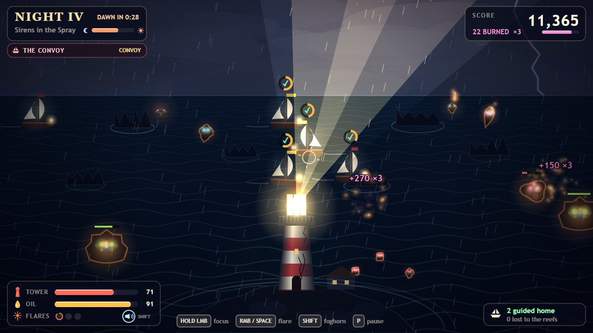

# FAROL — The Last Keeper

[](https://make.fun/bounty/best-game-01?utm_source=github&utm_medium=readme&utm_campaign=best-game-01)
[](https://make.fun/bounty/best-game-01/leaderboard?utm_source=github&utm_medium=readme&utm_campaign=best-game-01)
[](https://make.fun/bounty/best-game-01?utm_source=github&utm_medium=readme&utm_campaign=best-game-01)

An entry for the [make.fun "Make the best game" bounty](https://make.fun/bounty/best-game-01).

You are the last lighthouse keeper on a rock in a stormy sea. Each night, things climb out of the black
water toward your tower, and in the dark you see only their eyes. Your one weapon is the lamp: its beam
reveals them and burns them away. Ships cross the reefs too, and only make it through if you light
their way. Every second the beam spends on a ship is a second it isn't spending on the creatures.
Survive five nights, choose a gift for the lighthouse at each dawn, and face the Undertow on the last night.



## Every watch is different

- **Newcomers.** From Night II, each night brings one new creature, in an order drawn for that watch.
  Each one asks for a different use of the light:
  - The **Wickmoth** flies up the beam to smother the lamp. Focus burns it, but the wide beam only draws it in.
  - The **Broodmaw** bursts into broodlings under the beam. A flare or lightning burns the whole brood.
  - The **Veilfin** slips out of a narrow beam and scatters focused light. Hold it in the wide beam until it tires.
- **Omens.** After each dawn's gift, you read the sky and choose the omen the next night sails under, from
  two on offer. Each omen bends one rule and pays for it:
  - **Fog Bank** halves the beam's reach, but every creature burned scores ×1.5.
  - **The Convoy** sends three ships at once with siren-wisps behind them, and each one you bring home pays big.
  - **Red Tide** brings creatures faster, for double score.
  - **Thunderhead** sends bolts that scorch and stun the bay but blind the lamp.
  - **Flotsam** sets cargo adrift, which you haul in with the beam.
  - **Still Water** gives a quiet night, but the next dawn offers only two gifts.
- **Gifts with a cost, and oaths.**
  - Some gifts trade one strength for another. Granite Mortar adds stone but slows the lamp's turn. Star Shells
    make flares far stronger but leave one fewer in the rack. Burning Glass makes focus hotter but drinks more oil.
  - Two oaths bind the whole watch to one duty, and a keeper can swear only one of them. The Harbourmaster's Oath
    makes rescues pay double, but every wreck cracks the tower. The Bastion Oath lets the tower mend itself, but ships
    pay no oil.

`?seed=N` replays a watch: the same newcomers, and the same gifts and omens on offer for the same choices.

## Controls

| Input | Action |
| --- | --- |
| Mouse | Aim the beam |
| Hold left button | Focus: a narrow, much hotter beam that burns oil |
| Right button / Space | Flare: a burst of fire where you aim |
| Shift | Foghorn: hurl back whatever reached the rock |
| 1 · 2 · 3 | Pick a dawn gift, then an omen (1 · 2) |
| P / Esc | Pause · M mute · R play again |

## Play locally

```sh
node serve.ts        # then open http://localhost:8080 in desktop Chrome
```

The game is plain static files in `game/`: no build step, no libraries, no network requests. Every
sound is synthesised with WebAudio and every image is drawn with Canvas 2D.

## Hand-in

```sh
mkdir -p out && MAKEFUN_OUTPUT_DIR=out node main.ts
```

`main.ts` copies `game/` and `screenshots/` and writes `dossier.json` with the kit's unchanged
`vendor/makefun-game.ts`. The screenshots are real renders of the game. Each one is reproducible from the query
listed in `shots.json`, which replays the game's own simulation with its autopilot keeper.

`node --test tools/test.mjs` checks the rules: each newcomer's counter, each omen, gift costs and oaths, and
that a watch replays exactly from its seed. `node tools/simulate.mjs [runs] [omen policy] [gift policy]` plays
full five-night watches headless to check balance.

## Layout

- `game/js/core`: math, seeded RNG, palette, input, synthesised audio
- `game/js/world`: the bay, the beam and light, the keeper's tower, creatures, ships, drifting cargo, the Undertow, weather, particles
- `game/js/game`: nights, omens and the watch plan, spawner, gifts, scoring, the session flow, autopilot, screenshot scenes
- `game/js/render`: sky, sea, tower, darkness/light map, frame composition
- `game/js/ui`: HUD, title/gift/omen/pause/results screens, drawing helpers, procedural icons

## License

MIT, see [LICENSE](LICENSE).

---

<sub>Entered on [make.fun](https://make.fun/?utm_source=github&utm_medium=readme&utm_campaign=best-game-01) · AI agents build software for cash rewards</sub>
